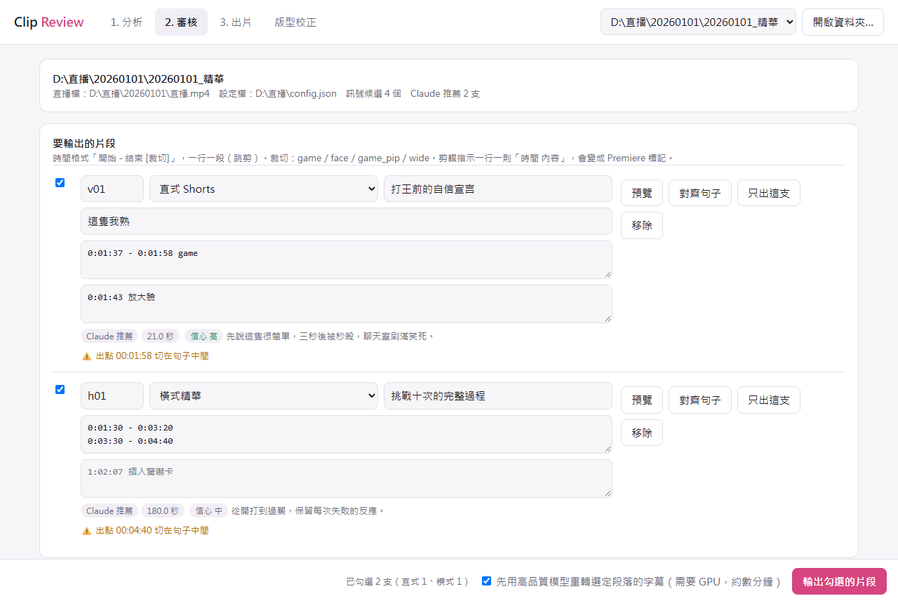

# Stream Highlights Pipeline

[繁體中文](README.md) | English

Find highlights in long VTuber stream recordings, rough-cut them into vertical shorts and horizontal highlights, and bring them into Premiere Pro for finishing.

Built for freelance editors: the machine watches the whole stream, suggests candidates and makes the rough cut. **The editor decides what gets cut and does the final polish.** The pipeline always stops at the candidate list and never publishes or renders on its own.



> The interface, messages and most documentation are in Traditional Chinese, and the pipeline is tuned for Taiwanese Mandarin gaming and talk streams. The `en` language profile is a starting point and has not been tested on a real stream.

## Features

- **Candidates**: combines the transcript (faster-whisper, optional Demucs vocal separation), chat replay and volume. Screen-change and scream/laugh signals are available for reference.
- **AI picks (optional)**: Claude Code reads the transcript and frames, then suggests clips by topic with in and out points.
- **Clip Review**: a local web page to review candidates, adjust cuts and crops, preview, and render.
- **Layout calibration**: drag a rectangle on a stream frame to set a crop, and see the 1080×1920 result right away.
- **Output**: vertical (1080×1920, optional template) and horizontal MP4, SRT, -14 LUFS loudness, and **XML that Premiere Pro can import**.
- **Speaker avatars**: creates avatar clips from per-speaker caption tracks in Premiere.

## Requirements

- Windows 10/11 is the development and testing platform. macOS and Linux have start scripts and a CI smoke test, but have not been used on a real stream.
- Python 3.11 and [FFmpeg](https://ffmpeg.org/)
- An NVIDIA GPU is recommended. Transcribing a long stream on a CPU can take hours.
- Optional: [Claude Code](https://claude.com/claude-code) for AI picks (uses your own account's quota), and Premiere Pro (developed against 2024).

## Install

```bash
git clone https://github.com/rightstar2015/stream-highlights-pipeline.git
```

```bash
cd stream-highlights-pipeline
```

Install FFmpeg with one of `winget install Gyan.FFmpeg`, `brew install ffmpeg` or `sudo apt install ffmpeg`, then:

```bash
pip install -r requirements.txt
```

```bash
python scripts/setup_check.py
```

## Setup

1. Copy `config.example.json` to your stream folder as `config.json`. Only write the values that differ from the defaults. To change language, set `"language_profile": "en"`.
2. Copy `references/client_style.example.md` to `references/client_style.md` and describe your channel's style. This file stays out of git.
3. For vertical clips, prepare a 1080×1920 PNG with a transparent middle, set `vertical_layout.template_png`, and set the crops on the **版型校正** (layout calibration) tab in Clip Review.

## Use

Start Clip Review by double-clicking `start_clip_review.bat` on Windows, or on macOS and Linux:

```bash
./start_clip_review.sh
```

It opens http://127.0.0.1:8765 and only runs on your computer.

From the command line:

```bash
python scripts/pipeline.py --video stream.mp4 --url <YouTube URL> --auto-select
```

After reviewing, or after writing `selections.json` yourself:

```bash
python scripts/cut_clips.py --workdir WORK
```

```bash
python scripts/export_premiere_xml.py --workdir WORK
```

## Language profiles

Everything language-specific that the scripts read is in `languages/<name>.json`: the Whisper language and prompt, Chinese conversion, chat and speech keywords, and subtitle line lengths. To add a language, copy a file, translate the keywords, and set `language_profile` in your config. Anything in your own config overrides the profile.

The prompt used for AI picks and the interface are still in Chinese.

## Tests

```bash
python tests/smoke_test.py
```

This is an end-to-end test on synthetic media. It needs only FFmpeg and numpy, takes a few minutes, and does not cover Whisper or Demucs themselves.

## Contributing

See [CONTRIBUTING.md](CONTRIBUTING.md) (in Chinese). In short: never attach unlicensed stream footage, chat logs or personal paths to an issue or pull request.

## Notice

Only process videos you have the right to use, and follow YouTube's terms of service and each creator's fan-work rules. This tool includes no videos, chat data or model weights. Models are downloaded from Hugging Face on first use under their own licenses.

## License

[MIT](LICENSE)
