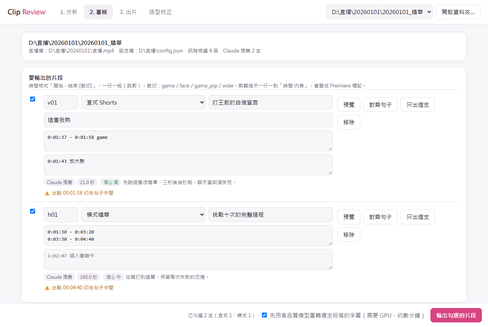
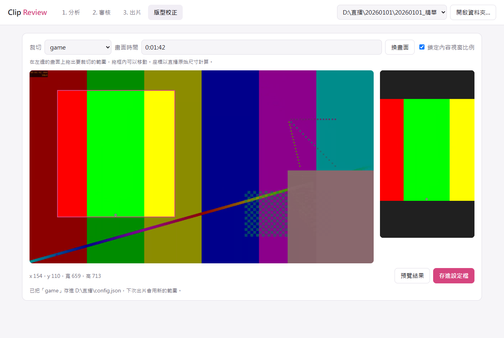

# Stream Highlights Pipeline

繁體中文 | [English](README.en.md)

從長時間的 Vtuber 直播錄影找出精華，粗剪成直式短片和橫式精華，再帶進 Premiere Pro 精修。

專為接案剪輯師設計：機器負責看完整場直播、挑候選、粗剪，**剪輯師決定要剪哪些片段，也負責最後的修飾**。系統一定會停在候選清單等你確認，不會自己出片。



## 功能

- **找候選**：整合逐字稿（faster-whisper＋選用的 Demucs 人聲分離）、聊天室重播、音量；另有畫面變化、尖叫／笑聲訊號可當參考
- **AI 挑選（選用）**：由 Claude Code 讀逐字稿和截圖，以話題為單位推薦片段並寫好進出點
- **Clip Review 介面**：本機網頁介面，可審核候選、改進出點和裁切、預覽，一鍵出片
- **版型校正**：在直播畫面上拖框設定裁切，馬上看到 1080×1920 的結果
- **輸出**：直式（1080×1920，可套版型）與橫式 MP4、繁體 SRT、響度 -14 LUFS，以及 **Premiere Pro 可匯入的 XML**
- **說話者頭像補軌**：依 Premiere 中分軌的字卡，自動產生對應的頭像片段

目前針對**台灣中文的遊戲直播與雜談**調整。其他語言可以換語言設定檔，見[語言設定](#語言設定)。

## 環境需求

- Windows 10／11（開發與實測環境）。macOS 和 Linux 有啟動腳本和自動測試，但還沒有用真實直播跑過
- Python 3.11、[FFmpeg](https://ffmpeg.org/)
- 建議有 NVIDIA 顯卡，用 CPU 轉錄長直播可能要好幾個小時
- 選用：[Claude Code](https://claude.com/claude-code)（AI 挑選需要，會使用你自己帳號的額度）；Premiere Pro（開發時使用 2024 版）

## 安裝

```
git clone https://github.com/rightstar2015/stream-highlights-pipeline.git
cd stream-highlights-pipeline
winget install Gyan.FFmpeg      # macOS：brew install ffmpeg；Linux：sudo apt install ffmpeg
pip install -r requirements.txt
```

有 NVIDIA 顯卡時再裝：

```
pip install nvidia-cublas-cu12 nvidia-cudnn-cu12
```

人聲分離（選用，遊戲直播建議裝，約 3 GB）：

```
pip install torch torchaudio --index-url https://download.pytorch.org/whl/cu128
pip install --no-deps demucs
pip install dora-search einops julius openunmix lameenc pyyaml tqdm
```

確認環境：

```
python scripts/setup_check.py
```

## 第一次設定

1. **設定檔**：把 `config.example.json` 複製到存放直播的資料夾，改名 `config.json`，填主播名、常被聽錯的詞（`text_replacements`）。只要寫跟預設不同的項目。
2. **風格檔**：把 `references/client_style.example.md` 複製成 `references/client_style.md`，填入你的頻道版型、長度和選題偏好。這個檔案不會進 git。
3. **直式版型**：準備 1080×1920、中間透明的 PNG，填進 `vertical_layout.template_png`，再到 Clip Review 的「版型校正」設定裁切：選一個裁切、在畫面上拖框、按「預覽結果」，確認後存進設定檔。設定檔只有這個裁切會被改動。

   

   不用介面時，可以產生附格線的畫面來量座標：

   ```
   python scripts/frames.py --video 直播.mp4 --workdir 工作資料夾 --calibrate 00:30:00
   ```

建議的資料夾結構：

```
D:\直播\
  config.json
  20260101\
    直播.mp4
    直播.live_chat.json
    20260101_精華\      ← 自動建立，所有分析資料與粗剪都在這裡
```

## 使用方式

### 用 Clip Review（圖形介面）

雙擊 `start_clip_review.bat`（macOS／Linux 執行 `./start_clip_review.sh`），瀏覽器會開啟 http://127.0.0.1:8765（只在本機執行）。

| 步驟 | 誰做 | 內容 |
|---|---|---|
| 1. 分析 | 你按按鈕，之後自動 | 選直播檔和聊天室（檔案或 YouTube 網址）。可勾選「讓 Claude 挑選」 |
| 2. 審核 | **你** | 勾選片段，調整進出點、裁切、標題、剪輯指示，可預覽 |
| 3. 出片 | 你按按鈕，之後自動 | 重轉字幕，輸出 MP4、SRT、Premiere XML |
| 4. 精修 | **你** | 在 Premiere 匯入 XML 和 SRT 繼續剪輯 |

審核時會即時提醒時間超出範圍、裁切不存在、長度不合建議、切在句子中間等問題，也可以按「對齊句子」調整剪點、按「剪掉停頓」把片段內的長停頓剪成跳剪（可以復原）、按「只出這支」單獨輸出；分析和出片都能中途停止。

參考耗時（6 小時多的直播，RTX 3060 12GB）：轉錄約 6 分鐘（未含人聲分離），AI 挑選約 3–9 分鐘。畫面分析預設跳過，開啟時約多 34 分鐘。

### 用指令

```
python scripts/pipeline.py --video 直播.mp4 --url <YouTube網址> --auto-select
```

已完成的步驟會跳過，可以中斷後續跑；換了直播檔或分析範圍時會提醒，要重跑請加 `--force`。要整晚排程，可以參考 `run_overnight.bat`（macOS／Linux 是 `run_overnight.sh`）。之後在 Clip Review 審核，或自己寫 `selections.json`，再執行：

```
python scripts/validate_selections.py --workdir 工作資料夾
python scripts/tighten.py --workdir 工作資料夾          # 選用：預覽剪掉停頓，確認後加 --write
python scripts/refine_transcript.py --workdir 工作資料夾
python scripts/cut_clips.py --workdir 工作資料夾
python scripts/export_premiere_xml.py --workdir 工作資料夾
```

### 當作 Claude Code Skill

把這個資料夾連結到 Claude Code 的 skills 資料夾（在 PowerShell 執行）：

```
New-Item -ItemType Junction -Path "$HOME\.claude\skills\stream-highlights-pipeline" -Target "<這個資料夾的完整路徑>"
```

macOS／Linux 用 `ln -s "<這個資料夾的完整路徑>" ~/.claude/skills/stream-highlights-pipeline`。

重新開啟 Claude Code，說「幫我剪這場直播的精華」並提供直播檔路徑。完整流程見 [SKILL.md](SKILL.md)。

## 匯入 Premiere Pro

- **XML**：工作資料夾裡的 `<直播檔名>_premiere.xml`，用「檔案 > 匯入」。每支片會變成一個序列；橫式序列直接引用原始直播檔，剪點可以延伸；直式序列放已套版型的 MP4。剪輯指示會變成序列標記，00:00 的標記會寫出要匯入的 SRT 檔名。加 `--vertical editable` 可讓直式序列改用原始直播檔加裁切與版型，剪點可以延伸。實驗功能（尚未在 Premiere 驗證）：config 的 `premiere.cards` 依 notes 文字放入片尾卡和轉場字卡。
- **字幕**：`clips/*.srt` 不在 XML 裡，要另外匯入後拖到序列上。
- **離線媒體**：直播檔被移動過時會出現，對它按右鍵選「連結媒體」。

## 其他工具

- `python tools/eval_selections.py --truth 人工選片.json --pred selections.draft.json`：評估推薦和人工選片的重疊。
- `python scripts/suggest_terms.py --original 原.srt --corrected 校正.srt`：從校正過的字幕找出固定會錯的詞。
- 出片時會把你對 Claude 推薦的修改記在 `references/feedback_log.md`（只留在本機），下次挑選會參考。

## 說話者辨識（選用）

多人連動時，可以標出每句字幕可能是誰說的，方便把字卡分軌。實測三人連動約 76% 正確，也可能多分出一位，**只能當草稿**，要對照畫面確認。原本的 SRT 不會被改動。

1. 到 [模型頁面](https://huggingface.co/pyannote/speaker-diarization-community-1) 同意條款，建立 Read 權限的 token，執行 `hf auth login` 登入。
2. 建議裝在獨立環境，以免影響其他套件：`pip install pyannote.audio`
3. 執行（整場約 2 分鐘／小時）：

```
python scripts/diarize.py --video 直播.mp4 --workdir 工作資料夾
python scripts/diarize.py --workdir 工作資料夾 --label
```

會產生 `clips/<片名>_說話者.srt`。在 `config.json` 加上 `"speakers": {"SPEAKER_01": "名字"}` 就會顯示名字。

## 語言設定

跟語言有關的設定都在 `languages/<名稱>.json`：Whisper 的語言和提示、簡轉繁、聊天室和語音關鍵字、字幕字數。在 `config.json` 寫 `"language_profile": "en"` 就能切換；要加新語言，複製一份檔案翻譯關鍵字即可。你自己在 `config.json` 寫的項目會蓋過語言設定檔。

目前有 `zh-TW`（預設）和 `en`。`en` 只是起點，還沒有用真實直播測過；介面和 AI 挑選的提示仍然是中文。

## 測試

```
python tests/smoke_test.py
```

使用合成素材做端對端測試，只需要 FFmpeg 和 numpy，約 2–3 分鐘，不涵蓋 Whisper 和 Demucs 本身。GitHub Actions 會在 Windows、Linux、macOS 上自動執行。

想參與開發請看 [CONTRIBUTING.md](CONTRIBUTING.md)。

## 已知限制

- 主要在單一頻道的真實直播上驗證過，其他頻道的畫面配置要自己校正裁切座標。
- `fetch_chat.py --url` 依賴 yt-dlp，YouTube 改版時可能失敗，請先更新 yt-dlp；還是不行時，可以先下載 `live_chat.json` 再用 `--chat-file` 指定。
- 畫面和尖叫／笑聲訊號是啟發式做法，實測對話題型精華的排名沒有穩定幫助，所以預設權重為 0，只當參考。
- 「剪掉停頓」依逐字稿的字時間判斷，拉長的字尾和氣音可能被當成停頓剪掉。需要延伸剪點時，直式請用 `--vertical editable` 匯出 XML（MP4 版的剪點無法延伸）。
- Whisper 可能聽錯字，特別是配樂大聲或專有名詞多的段落，字幕仍需人工校對。
- Premiere 的文字圖層和 MOGRT 無法透過 XML 來回，說話者頭像工具因此只輸出新增的頭像片段。

## 使用須知

請只處理你有權使用的影片，並遵守 YouTube 服務條款與創作者的二創規範。本工具不包含任何影片、聊天室資料或模型權重；模型會在第一次使用時從 Hugging Face 下載，適用各自的授權。

## 授權

[MIT](LICENSE)
